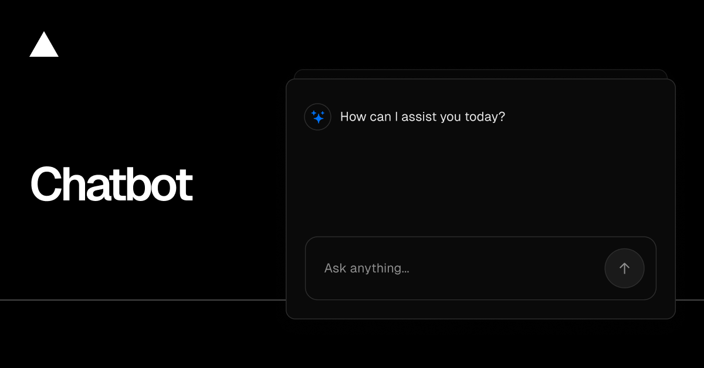

<a href="/">
  
  <h1 align="center">Healthcare Support</h1>
</a>

<p align="center">
    Healthcare Support is an AI assistant for clinical imaging guidelines and product knowledge, built with Next.js and the AI SDK.
</p>

<p align="center">
  <a href="#features"><strong>Features</strong></a> ·
  <a href="#model-providers"><strong>Model Providers</strong></a> ·
  <a href="#running-locally"><strong>Running locally</strong></a>
</p>
<br/>

## Product plan

Roadmap for the **TB & pneumonia doctor assistant** (Next.js + FastAPI + custom vision + RAG + Hugging Face ops):

→ **[docs/PLAN.md](docs/PLAN.md)**

## Features

- [Next.js](https://nextjs.org) App Router
  - Advanced routing for seamless navigation and performance
  - React Server Components (RSCs) and Server Actions for server-side rendering and increased performance
- [AI SDK](https://ai-sdk.dev/docs/introduction)
  - Unified API for generating text, structured objects, and tool calls with LLMs
  - Hooks for building dynamic chat and generative user interfaces
  - Talks directly to Groq, MixRoute, and a custom LangChain backend — no gateway in between
- [shadcn/ui](https://ui.shadcn.com)
  - Styling with [Tailwind CSS](https://tailwindcss.com)
  - Component primitives from [Radix UI](https://radix-ui.com) for accessibility and flexibility
- Data Persistence
  - [Postgres](https://www.postgresql.org) for saving chat history and user data
  - S3-compatible object storage (e.g. [MinIO](https://min.io)) for image/file attachments
- [Auth.js](https://authjs.dev)
  - Simple and secure authentication

## Model Providers

- **Groq** (`GROQ_API_KEY`) — default chat models (`groq/llama-3.3-70b-versatile`, etc.)
- **MixRoute** (`MIXROUTE_API_KEY`) — OpenAI-compatible multi-model gateway
- **LangChain backend** (`LANGCHAIN_API_URL`) — custom RAG model `langchain/healthcare-rag`
- Optional **OpenAI** (`OPENAI_API_KEY`) if you add `openai/*` models later

### Environment variables

| Variable | Required to chat? | Needed for |
|---|---|---|
| `POSTGRES_URL` | Yes | Auth + chat history |
| `GROQ_API_KEY` | Yes (for Groq models) | Default LLM |
| `MIXROUTE_API_KEY` | For MixRoute models | Multi-model gateway |
| `LANGCHAIN_API_URL` | For LangChain model/RAG | Custom backend |
| `S3_*` (see `.env.example`) | No | Image/file attachments |
| `REDIS_URL` | No | Resumable streams + prod IP rate limits |

You can run locally with Auth + Postgres + Groq, then add S3/Redis/LangChain later.

## Custom models + LangChain RAG

This project keeps **AI SDK** in Next.js and puts **LangChain** in `ai-backend/`:

- Model `langchain/healthcare-rag` → `POST http://localhost:8001/v1/chat/completions`
- Tool `searchKnowledge` → `POST http://localhost:8001/rag/search`

```powershell
# Terminal 1 — LangChain backend
cd ai-backend
py -3 -m venv .venv
.\.venv\Scripts\Activate.ps1
pip install -r requirements.txt
uvicorn app.main:app --reload --port 8001

# Terminal 2 — Next.js chatbot
pnpm install
pnpm dev
```

Set in `.env.local`:

```
LANGCHAIN_API_URL=http://localhost:8001
LANGCHAIN_API_KEY=
```

See [ai-backend/README.md](ai-backend/README.md) for details.

## File attachments (optional)

Uploads go to any S3-compatible object store. For local development, MinIO works out of the box:

```bash
docker run -p 9000:9000 -p 9001:9001 minio/minio server /data --console-address ":9001"
```

Create a bucket in the MinIO console (http://localhost:9001), then set the `S3_*` variables from `.env.example`. When `S3_PUBLIC_URL` is unset, files are served through the authenticated `/api/files/*` route and the bucket stays private.

## Running locally

Copy [`.env.example`](.env.example) to `.env.local` and fill in the values. A plain `.env`/`.env.local` file is all that is necessary.

> Note: You should not commit your `.env` file or it will expose secrets that will allow others to control access to your various AI and authentication provider accounts.

```bash
pnpm install
pnpm db:migrate # Setup database or apply latest database changes
pnpm dev
```

Your app should now be running on [localhost:3000](http://localhost:3000).
